<div align="center">

# OpenKido

**Audit de sécurité de vos dépôts GitHub et de vos domaines — en un seul endroit.**

Dépendances vulnérables, paquets malveillants, secrets oubliés dans le code, mauvaises configurations GitHub, licences à risque, certificats SSL : OpenKido réunit tout dans une liste unique, triée par gravité, avec la façon de corriger chaque problème.

[](https://github.com/burotica49/Openkido/actions/workflows/ci.yml)

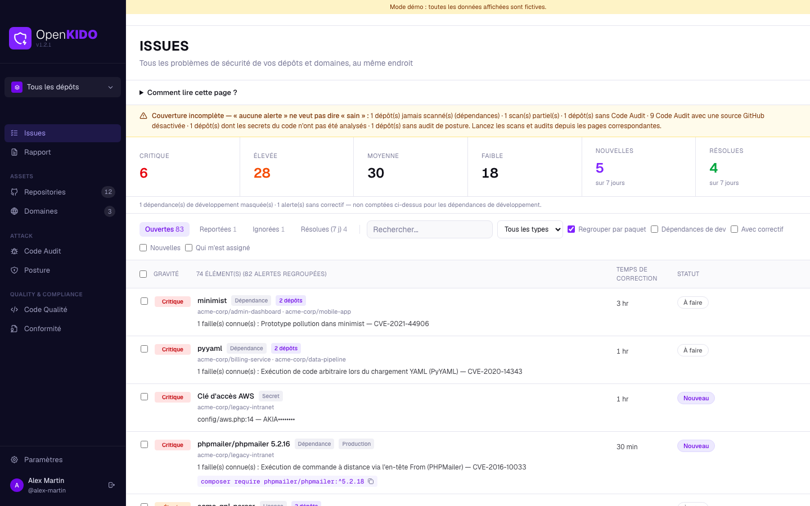

<sub>Toutes les captures de ce document utilisent des **données fictives** (mode démo, voir [Régénérer les captures](#régénérer-les-captures-décran)).</sub>

</div>

---

## Sommaire

- [Présentation](#présentation)
- [Fonctionnalités](#fonctionnalités)
- [Installation](#installation)
- [Configuration](#configuration)
- [Premiers pas](#premiers-pas)
- [Sécurité et confidentialité](#sécurité-et-confidentialité)
- [Limites connues](#limites-connues)
- [Architecture](#architecture)
- [Développement](#développement)
- [Documentation complémentaire](#documentation-complémentaire)

---

## Présentation

OpenKido s'adresse aux développeurs et aux petites équipes qui veulent une vision claire de la sécurité de **tous leurs dépôts GitHub** sans mettre en place une plateforme complète. Vous vous connectez avec GitHub, l'application analyse vos dépôts et vos noms de domaine, puis vous présente les problèmes à traiter, du plus grave au moins grave.

Quelques principes guident l'application :

- **Lecture seule.** OpenKido ne modifie jamais vos dépôts ni leurs réglages. Chaque problème indique le réglage ou la commande à appliquer vous-même.
- **Jamais de faux « sain ».** Chaque résultat est à trois états : réussi, en échec, ou *non évaluable* (droits insuffisants, service injoignable…). Un contrôle qu'on n'a pas pu vérifier n'est jamais compté comme réussi, et les pages signalent explicitement ce qui n'a pas été analysé.
- **Vos données restent chez vous.** Les résultats sont stockés dans une base SQLite locale. Le jeton GitHub n'est jamais envoyé au navigateur.
- **Compréhensible sans être expert.** Chaque page a un encart « Comment lire cette page ? », chaque contrôle explique *pourquoi il compte* et *comment le corriger*.

Deux façons de l'utiliser : une **application de bureau macOS** (Electron) ou une **instance web** (Docker, par exemple sur Dokploy).

---

## Fonctionnalités

### Issues : le Feed unifié

Tous les problèmes de tous vos dépôts et domaines dans une seule liste triée par gravité (critique, élevée, moyenne, faible).

- **Panneau de détail à droite** : explication en clair, liste des failles avec la version à atteindre (`4.17.15 → 4.17.21`), commande de correction à copier.
- **Regroupement par paquet** : une dépendance présente dans plusieurs dépôts n'apparaît qu'une fois, avec le détail par dépôt.
- **Temps de correction estimé** (indicatif) et **statut** : *Nouveau*, *À faire*, *Reportée*, *Ignorée*.
- **Cartes « Nouvelles » et « Résolues »** sur 7 jours : une alerte est résolue quand un nouveau scan ne la détecte plus.
- **Gérer les alertes** : ignorer avec un motif (faux positif, risque accepté…), reporter 7, 30 ou 90 jours, assigner. Rien n'est supprimé et rien n'est modifié sur GitHub ; ces choix sont personnels.
- **Moins de bruit** : les dépendances de développement (non livrées en production) sont masquées par défaut et exclues des compteurs ; les failles sans correctif sont signalées et classées après les autres.
- Chaque dépôt a aussi son propre onglet **Issues**.

| Détail d'une alerte | Dépendance présente dans plusieurs dépôts |
|---|---|
| 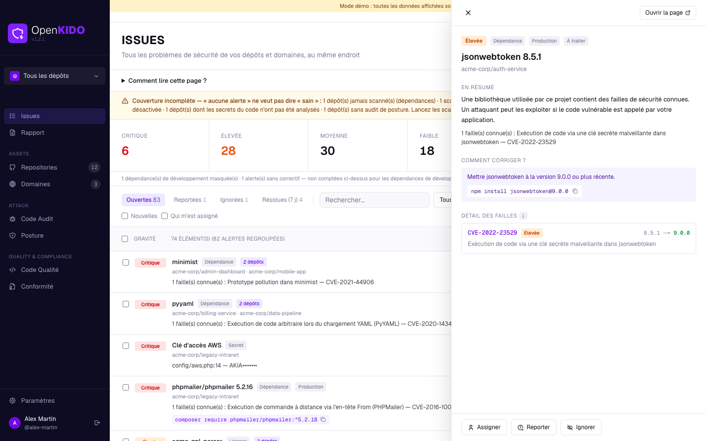 | 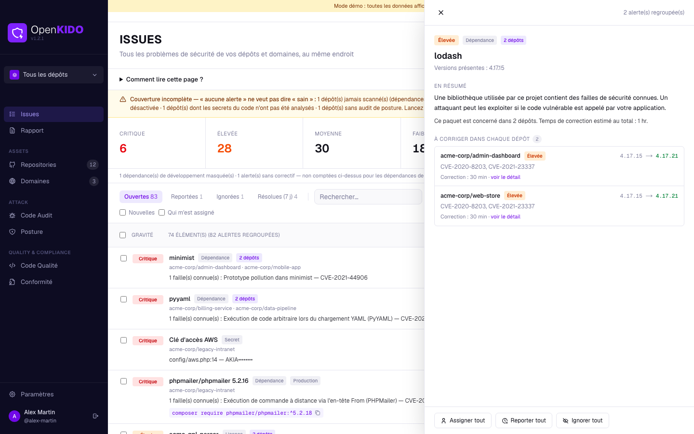 |

### Repositories : dépendances et vulnérabilités

Pour chaque dépôt, OpenKido lit les fichiers de dépendances et interroge la base publique **OSV.dev**.

- **Lockfiles et manifestes lus** : `package-lock.json`, `npm-shrinkwrap.json`, `yarn.lock` (v1 et Berry), `pnpm-lock.yaml` (v5 à v9), `package.json`, `requirements.txt`, `Pipfile.lock`, `poetry.lock`, `go.mod`, `Cargo.lock`, `composer.lock`, `Gemfile.lock`. Maven, Gradle et NuGet sont couverts via le *dependency graph* de GitHub (SBOM) quand il est activé sur le dépôt.
- **Version exacte d'abord** : un lockfile donne la version réellement installée ; à défaut, la borne déclarée est analysée et signalée comme telle.
- **Paquets malveillants** (identifiants `MAL-` d'OSV) et **licences** de chaque dépendance de production (GPL, AGPL, absence de licence…, via deps.dev).
- **Évolution dans le temps** (historique des scans) et analyse automatique en arrière-plan des dépôts non scannés depuis plus de 24 h.
- Un scan **partiel** (service injoignable pour une partie des composants) est signalé et ne remplace jamais un scan complet.
- Onglets **Pull Requests** (vos PR ouvertes) et **Checks**.

| Liste des dépôts | Vue d'ensemble d'un dépôt |
|---|---|
| 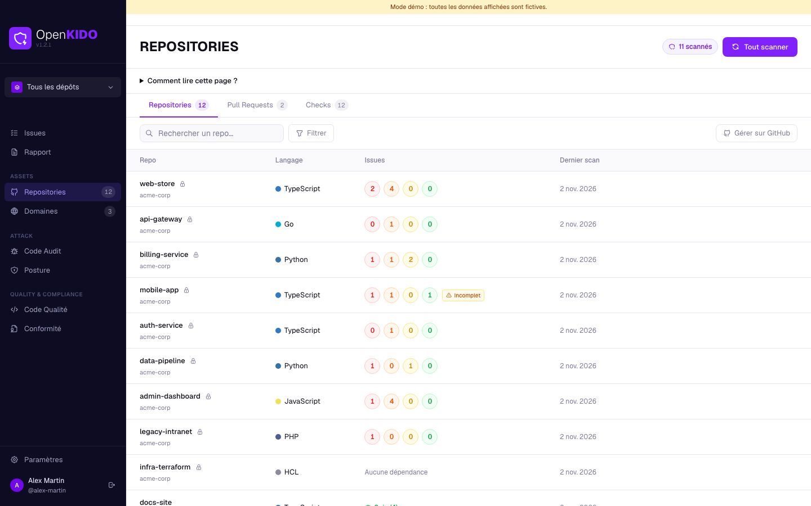 | 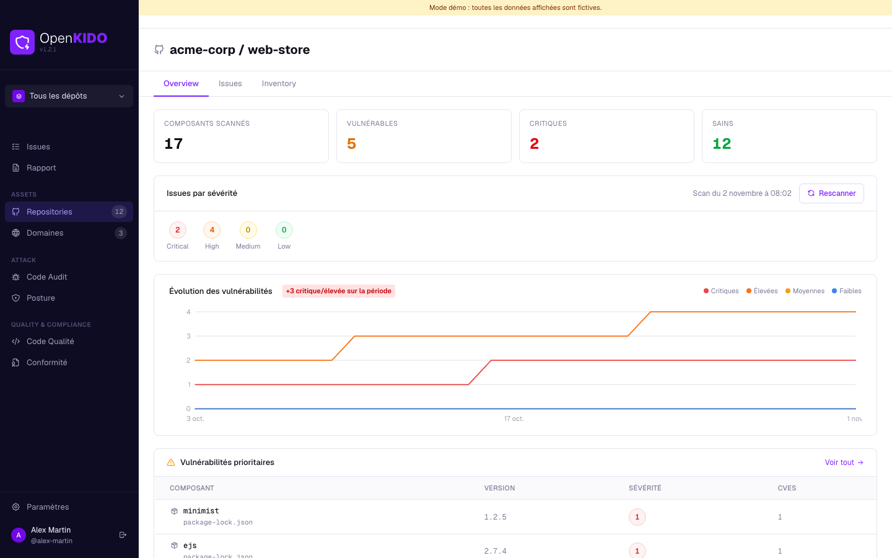 |

L'**inventaire** liste chaque composant (direct ou transitif, production ou développement) ; un clic ouvre le détail à droite.

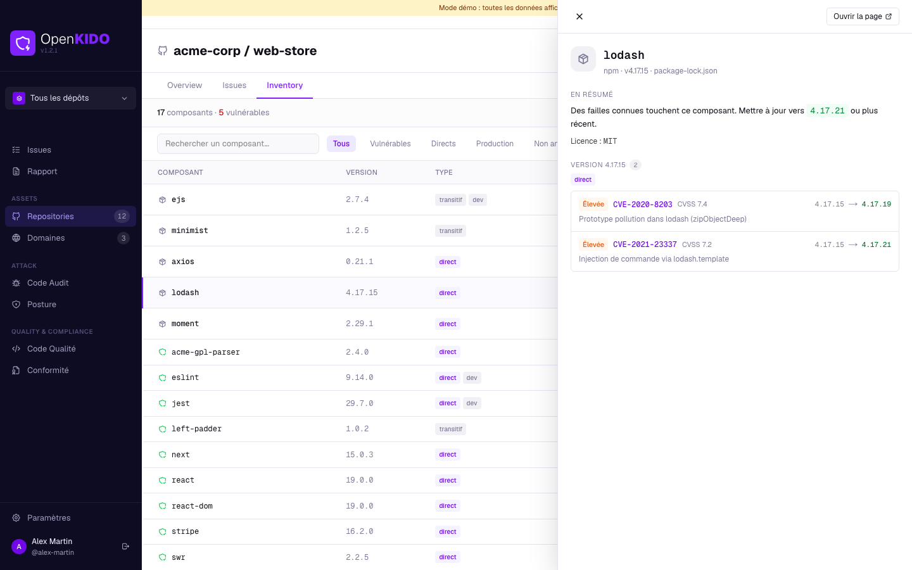

### Code Audit : alertes GitHub et secrets dans le code

- Alertes **GitHub Code Scanning (CodeQL)**, **Dependabot** et **Secret Scanning**. Une fonction désactivée sur le dépôt est affichée comme « Désactivé », jamais comme « aucune alerte ».
- **Détection de secrets par OpenKido**, indépendante de GitHub (donc utilisable sur les dépôts privés sans option payante) : clés AWS, jetons GitHub / Slack / Stripe / Google / OpenAI / Anthropic / npm / SendGrid / Supabase, clés privées, identifiants dans les URL de bases de données, mots de passe en clair. Les valeurs ne sont **jamais enregistrées**, seulement un aperçu masqué.

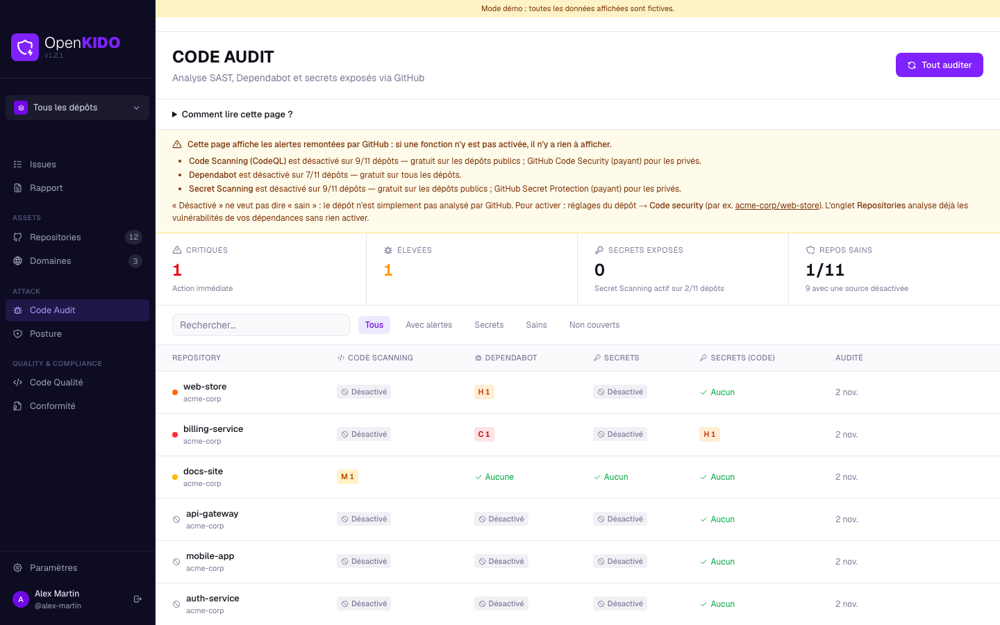

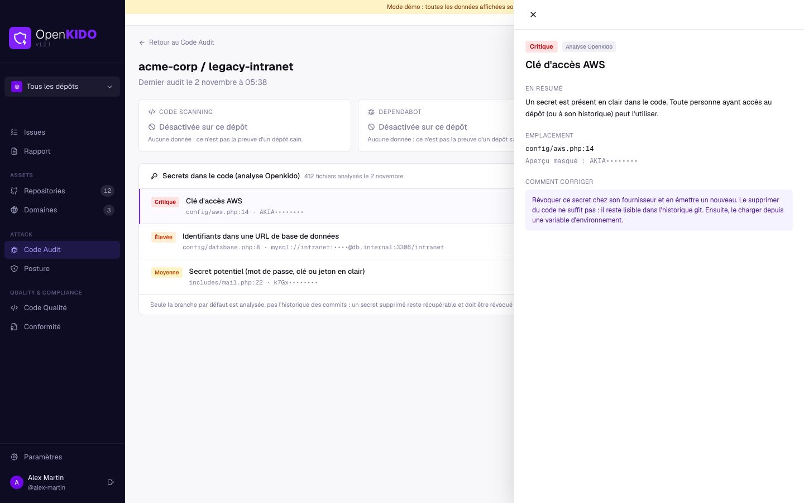

### Posture : la configuration de sécurité de vos dépôts

**27 contrôles** en 6 familles, alignés sur [OpenSSF Scorecard](https://securityscorecards.dev) : protection de la branche principale et revues, fonctions de sécurité GitHub (Dependabot, Secret Scanning, CodeQL, push protection), workflows GitHub Actions (actions épinglées, permissions du `GITHUB_TOKEN`, `pull_request_target` dangereux), fichiers sensibles versionnés, gouvernance (`SECURITY.md`, `CODEOWNERS`, licence, lockfiles) et accès (clés de déploiement, webhooks, collaborateurs).

Le score est pondéré par la gravité ; les contrôles non évaluables en sont exclus. Chaque contrôle indique la preuve observée, pourquoi il compte et le lien du réglage à changer.

| Posture de tous les dépôts | Détail d'un contrôle |
|---|---|
| 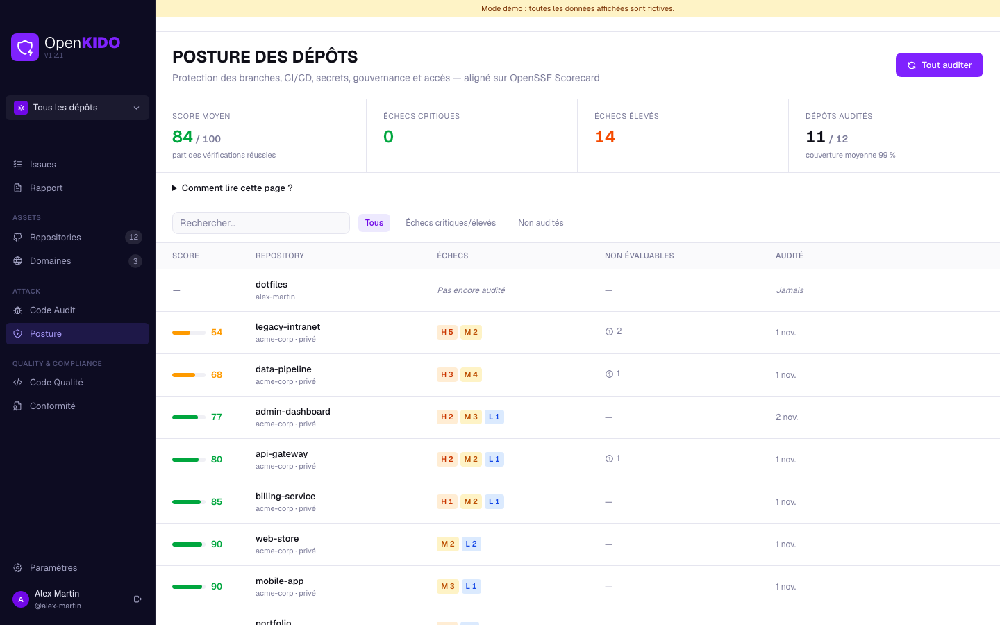 | 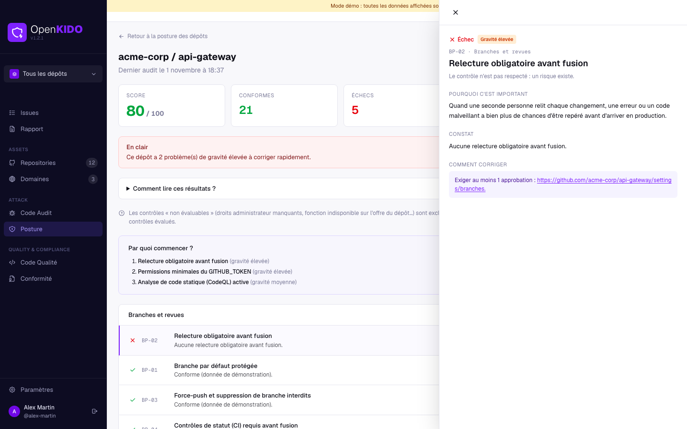 |

### Code Qualité et Conformité

- **Code Qualité** : score sur 100 selon les bonnes pratiques présentes (CI/CD, tests, linting, formatage, TypeScript, README, changelog, EditorConfig).
- **Conformité** : traduit vos résultats de scan en contrôles de référentiels reconnus — **SOC 2**, **ISO 27001**, **OWASP Top 10** et **PCI DSS**. Utile pour préparer un audit ; cela ne remplace pas une certification.

| Code Qualité | Conformité |
|---|---|
| 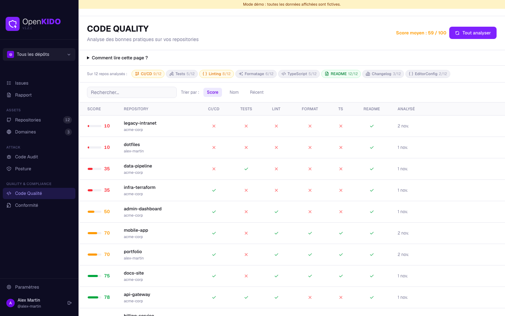 | 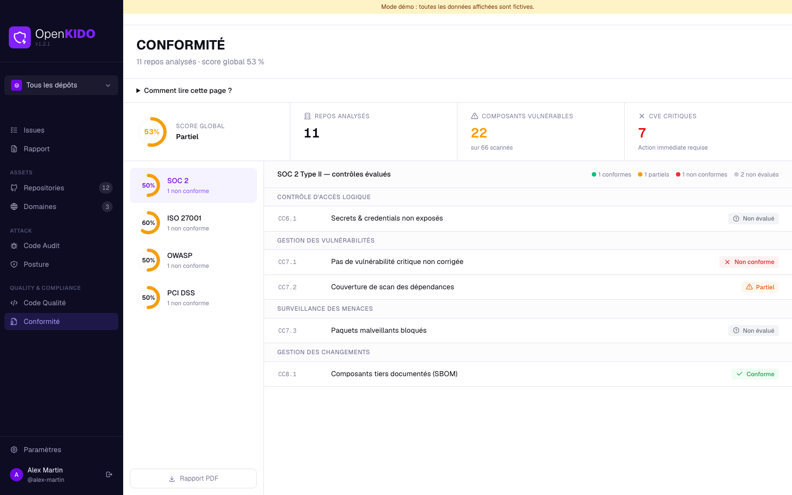 |

### Domaines

Surveillance de vos noms de domaine : joignabilité, certificat SSL (validité, émetteur, jours restants), redirection HTTP → HTTPS et en-têtes de sécurité (HSTS, CSP, X-Frame-Options, X-Content-Type-Options, Referrer-Policy).

Dans le détail d'un domaine, une **analyse approfondie [Sucuri SiteCheck](https://sitecheck.sucuri.net)** peut être lancée à la demande : malware, listes noires, CMS et PHP obsolètes, défauts de durcissement, note de A à F. Elle n'est jamais automatique, car le nom de domaine est alors transmis à Sucuri.

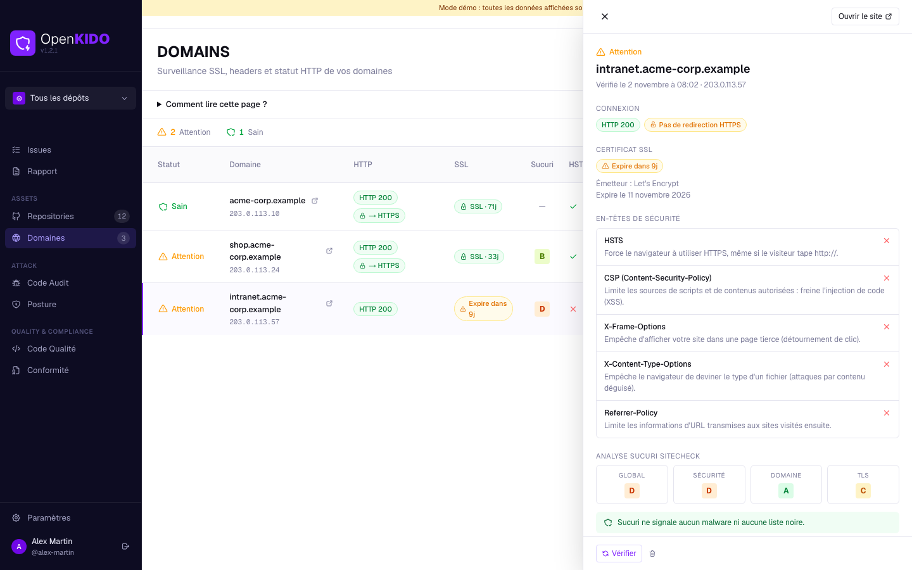

### Rapport PDF

Une page **Rapport** synthétise l'état de sécurité : chiffres clés, couverture et limites de l'analyse, priorités avec l'action recommandée, situation par dépôt, malware, secrets, licences, domaines et registre des risques acceptés ou reportés. **Exporter en PDF** ouvre une fenêtre d'enregistrement dans l'application de bureau (impression vers PDF dans un navigateur).

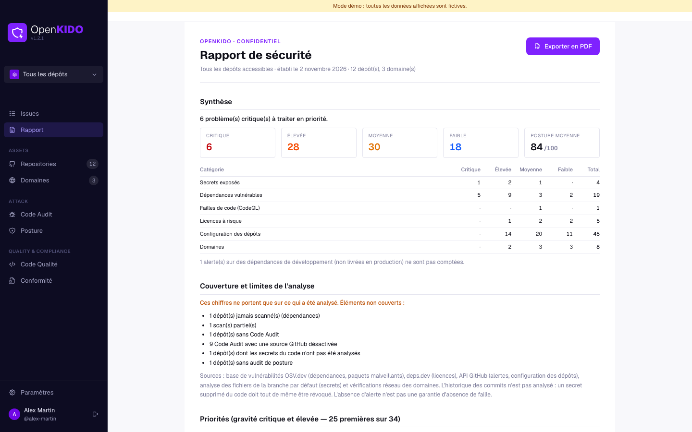

### Et aussi

- **Sélecteur d'organisation** : tous les dépôts, votre compte personnel ou une organisation donnée ; il filtre toutes les pages.
- **Paramètres** : compte GitHub, diagnostic (base de données, port du serveur local) et liens vers le dépôt et la documentation.
- **Aide intégrée** sur chaque page et infobulles pour les termes techniques.

---

## Installation

Dans tous les cas, OpenKido a besoin d'une **application OAuth GitHub** (voir [Configuration](#configuration)).

### Application de bureau (macOS)

L'application embarque son propre serveur local ; rien à installer à côté. Les installeurs ne sont pas publiés automatiquement : construisez-les depuis les sources.

Prérequis : macOS, Node.js 22 ou plus récent, et un fichier `.env.local` renseigné (voir [Configuration](#configuration)).

```bash
git clone https://github.com/burotica49/Openkido.git
cd Openkido
npm install
cp .env.local.example .env.local   # puis renseignez les valeurs
npm run electron:build:mac
```

Les images disque sont créées dans `dist/mac/` : `OpenKido-<version>-arm64.dmg` (Apple Silicon) et `OpenKido-<version>.dmg` (Intel). Ouvrez le DMG, glissez OpenKido dans *Applications*, puis lancez l'application.

- **Signature** : si une identité « Developer ID » est présente dans votre trousseau, electron-builder signe l'application. Sans identité, définissez `CSC_IDENTITY_AUTO_DISCOVERY=false` ; macOS peut alors refuser l'ouverture (clic droit → *Ouvrir*, ou `xattr -dr com.apple.quarantine /Applications/OpenKido.app`). Les builds ne sont pas notarisés.
- **Port** : le serveur local utilise le port **3000** s'il est libre, sinon le suivant disponible (3001…). Le port utilisé est affiché dans *Paramètres → Diagnostic*.
- **Données** : la base SQLite est stockée dans le dossier de l'application (`~/Library/Application Support/openkido/openkido.db`) ; les journaux du serveur local sont dans le dossier de logs d'Electron (`server.log`).
- ⚠️ Le fichier `.env.local` (dont le secret OAuth) est **embarqué dans l'installeur**. Ne distribuez pas les DMG en dehors de votre organisation ([détails](SECURITY.md)).

### Instance web (Docker / Dokploy)

Le `Dockerfile` produit une image Next.js autonome (utilisateur non-root, vérification de santé intégrée). La base SQLite est dans le volume `/data` : **montez-le** pour conserver vos données.

```bash
docker build -t openkido .
docker run -d --name openkido -p 3000:3000 -v openkido-data:/data \
  -e AUTH_SECRET="$(openssl rand -base64 32)" \
  -e AUTH_URL="https://openkido.example.com" \
  -e GITHUB_CLIENT_ID="…" -e GITHUB_CLIENT_SECRET="…" \
  -e ALLOWED_GITHUB_LOGINS="votre-login" \
  openkido
```

Sur **Dokploy**, créez une application à partir du dépôt (build `Dockerfile`), déclarez les variables d'environnement ci-dessus, ajoutez un volume persistant monté sur `/data` et exposez le port 3000 derrière HTTPS. Les migrations de base de données s'appliquent automatiquement au démarrage.

> **Important :** sans `ALLOWED_GITHUB_LOGINS` et/ou `ALLOWED_GITHUB_ORGS`, n'importe quel compte GitHub peut se connecter à votre instance.

### Développement local

```bash
npm install
cp .env.local.example .env.local   # puis renseignez les valeurs
npm run dev                        # http://localhost:3000
```

La base de données (`prisma/openkido.db`) est créée et migrée automatiquement au démarrage du serveur.

---

## Configuration

### 1. Créer l'application OAuth GitHub

Sur [github.com/settings/developers](https://github.com/settings/developers) → *OAuth Apps* → *New OAuth App* :

| Usage | Homepage URL | Authorization callback URL |
|---|---|---|
| Bureau et développement | `http://localhost:3000` | `http://localhost:3000/api/auth/callback/github` |
| Instance web | `https://openkido.example.com` | `https://openkido.example.com/api/auth/callback/github` |

L'application demande les droits `read:user user:email repo read:org` : lecture des dépôts (y compris privés) et des organisations. OpenKido n'écrit rien sur GitHub.

### 2. Variables d'environnement

| Variable | Obligatoire | Rôle |
|---|---|---|
| `GITHUB_CLIENT_ID` | oui | Identifiant de l'application OAuth GitHub |
| `GITHUB_CLIENT_SECRET` | oui | Secret de l'application OAuth GitHub |
| `AUTH_SECRET` | oui | Secret de signature des sessions (`openssl rand -base64 32`), unique par instance |
| `AUTH_URL` | instance web | URL publique de l'instance |
| `ALLOWED_GITHUB_LOGINS` | instance web | Logins GitHub autorisés, séparés par des virgules |
| `ALLOWED_GITHUB_ORGS` | instance web | Organisations dont les membres sont autorisés (cumulable avec la liste précédente) |
| `DATABASE_URL` | non | Base SQLite (`file:/data/openkido.db` dans l'image Docker ; `prisma/openkido.db` par défaut en local) |

Le fichier `.env.local` est ignoré par git : ne le commitez jamais.

---

## Premiers pas

1. **Connectez-vous avec GitHub**, puis choisissez dans le sélecteur d'organisation le périmètre à analyser.
2. **Repositories → Tout scanner** : analyse les dépendances de tous les dépôts (les dépôts jamais scannés ou dont le scan a plus de 24 h le sont aussi automatiquement en arrière-plan).
3. **Code Audit → Tout auditer** : lit les alertes GitHub et analyse les secrets dans le code.
4. **Posture → Tout auditer** : contrôle la configuration de chaque dépôt.
5. **Domaines** : ajoutez vos noms de domaine ; la vérification se lance à l'ajout.
6. Ouvrez **Issues** : toutes les alertes sont réunies, triées par gravité. Traitez le haut de la liste, ignorez ou reportez le reste avec un motif.
7. **Rapport** : exportez un PDF à partager.

Le bandeau « Couverture incomplète » de la page Issues liste ce qui n'a pas encore été analysé : tant qu'il est affiché, « aucune alerte » ne veut pas dire « sain ».

---

## Sécurité et confidentialité

**Où vont vos données**

| Destinataire | Ce qui est envoyé | Quand |
|---|---|---|
| API GitHub | Requêtes de lecture avec votre jeton (dépôts, fichiers de dépendances, alertes, réglages, archive de la branche par défaut pour la détection de secrets) | À chaque scan ou audit |
| [OSV.dev](https://osv.dev) | Noms et versions de paquets (jamais votre code) | À chaque scan |
| [deps.dev](https://deps.dev) | Noms et versions de paquets, pour les licences | À chaque scan (résultat mis en cache) |
| [Sucuri SiteCheck](https://sitecheck.sucuri.net) | Un nom de domaine | **Uniquement** quand vous lancez l'analyse d'un domaine |

**Protections en place** (détails dans [SECURITY.md](SECURITY.md) et [AUDIT.md](AUDIT.md)) : jeton GitHub jamais exposé au navigateur ; session vérifiée par chaque action serveur ; entrées validées ; vérifications réseau des domaines protégées contre le SSRF ; en-têtes de sécurité et CSP à nonce ; liste blanche de comptes et d'organisations pour l'instance web ; application de bureau avec fenêtre isolée (`sandbox`, `contextIsolation`), navigation restreinte et permissions refusées par défaut.

Pour signaler une vulnérabilité, suivez [SECURITY.md](SECURITY.md) (n'ouvrez pas d'issue publique).

---

## Limites connues

- **Historique git non analysé** pour les secrets : seule la branche par défaut est lue. Un secret supprimé du code reste récupérable dans l'historique et doit être révoqué chez son fournisseur.
- **Fonctions GitHub payantes** : Code Scanning et Secret Scanning ne sont gratuits que sur les dépôts publics ; sur les dépôts privés elles apparaissent « Désactivé » (la détection de secrets d'OpenKido couvre ce manque en partie).
- **Précision des vulnérabilités** : OpenKido signale les composants concernés par une faille connue, sans analyser si le code vulnérable est réellement appelé.
- **Sucuri SiteCheck** repose sur une API publique non documentée officiellement et peut limiter le nombre d'analyses.
- **Application de bureau** : macOS uniquement, non notarisée, et le secret OAuth est embarqué dans l'installeur (usage interne).
- **Pas de licence open source** définie pour l'instant : sauf accord de l'auteur, tous droits réservés.

---

## Architecture

| Couche | Technologies |
|---|---|
| Interface et serveur | Next.js 16 (App Router, Server Actions, `proxy.ts` pour la CSP), React 19, Tailwind CSS 4, shadcn/ui (Base UI) |
| Authentification | Auth.js (next-auth v5) avec GitHub |
| Données | SQLite via Prisma 7 et `@libsql/client` ; migrations SQL appliquées au démarrage du serveur |
| Application de bureau | Electron 43 : le serveur Next.js (mode *standalone*) tourne dans un `utilityProcess` lié à `127.0.0.1` |
| Tests et CI | Vitest, GitHub Actions (types, tests, audit des dépendances) |

```
src/
├── app/            Pages (App Router) : issues, repos, code-audit, posture, code-quality, compliance, domains, report, settings
├── components/     Interface (panneaux de détail, tableaux, aide) et composants shadcn/ui
├── lib/
│   ├── issues-core.ts      Feed : normalisation, regroupement, estimation, suivi nouvelles/résolues
│   ├── osv.ts, lockfiles.ts, scan.ts      Analyse des dépendances
│   ├── controls/           Moteur des 27 contrôles de posture
│   ├── secret-rules.ts, secrets.ts        Détection de secrets
│   ├── licenses*.ts, sucuri*.ts           Licences et analyse de domaines
│   └── actions/            Server Actions (session vérifiée à chaque appel)
electron/           Processus principal et preload de l'application de bureau
prisma/             Schéma et migrations
scripts/            Construction de l'app de bureau, mode démo et captures d'écran
```

---

## Développement

```bash
npm run dev            # serveur de développement
npm test               # tests (Vitest)
npm run typecheck      # vérification des types
npm run lint           # ESLint
npm run build          # build de production Next.js
```

Application de bureau :

```bash
npm run electron:dev          # Next.js + Electron en développement
npm run electron:build:mac    # DMG signés (arm64 et x64) dans dist/mac/
```

Le build de bureau ajoute lui-même les modules natifs de chaque architecture (`@libsql`, `sharp`) : une app Intel construite sur un Mac Apple Silicon fonctionne.

Base de données : le schéma est dans `prisma/schema.prisma` ; créez une migration avec `npx prisma migrate dev --name <nom>`. Les migrations sont appliquées automatiquement au démarrage du serveur (y compris dans l'application de bureau, sur les bases créées par une version précédente).

### Régénérer les captures d'écran

Les captures de ce document sont produites à partir de **données fictives**, sans aucun appel à GitHub : le mode démo (`OPENKIDO_DEMO=1`) remplace l'API GitHub par des dépôts imaginaires, et `scripts/seed-demo.ts` remplit une base de démonstration. Il faut Google Chrome.

```bash
npm run build
npm run demo:screenshots      # écrit docs/screenshots/*.png
```

Si Chrome n'est pas à l'emplacement habituel, indiquez-le avec `CHROME_PATH`. N'activez jamais `OPENKIDO_DEMO` sur une vraie instance.

---

## Documentation complémentaire

- [SECURITY.md](SECURITY.md) — signalement d'une vulnérabilité et réglages obligatoires du déploiement web.
- [AUDIT.md](AUDIT.md) — audit interne de sécurité et de fonctionnalités (état au 21 octobre 2026 ; plusieurs constats ont été corrigés depuis) et pistes d'analyse approfondie des dépôts.
